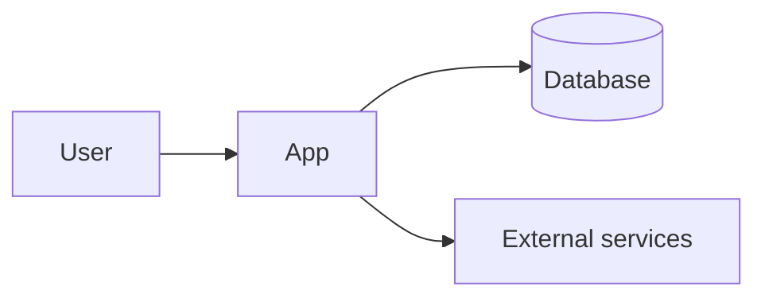

# Architecture: {{NAME}}

## Overview

## Stack
| Part | Choice | Why (in plain words) |
|---|---|---|

## Data entities
| Entity | Main fields | Relations |
|---|---|---|

## Permissions
| Action | Type A | Type B |
|---|---|---|

## Integrations
| Service | What for | If it goes down… |
|---|---|---|

## Security and privacy
- Login:
- Who sees what:
- Sensitive data / data-protection law:
- Backups:

## Decisions
- We chose X over Y because…
